# ☁️ Highly Available 2-Tier AWS Architecture with Terraform

A production-inspired, highly available AWS architecture built entirely with Terraform.

This project deploys a multi-AZ web application architecture using an Application Load Balancer, Auto Scaling Group, private EC2 instances, NAT Gateways, Amazon RDS MySQL, AWS Systems Manager Session Manager, and Amazon CloudWatch.

The architecture was not only deployed. It was deliberately tested for failure, recovery, database persistence, monitoring, and complete infrastructure teardown.

**Built. Tested. Broken on purpose. Recovered. Monitored. Destroyed. 💚**

---

## 🏗️ Architecture

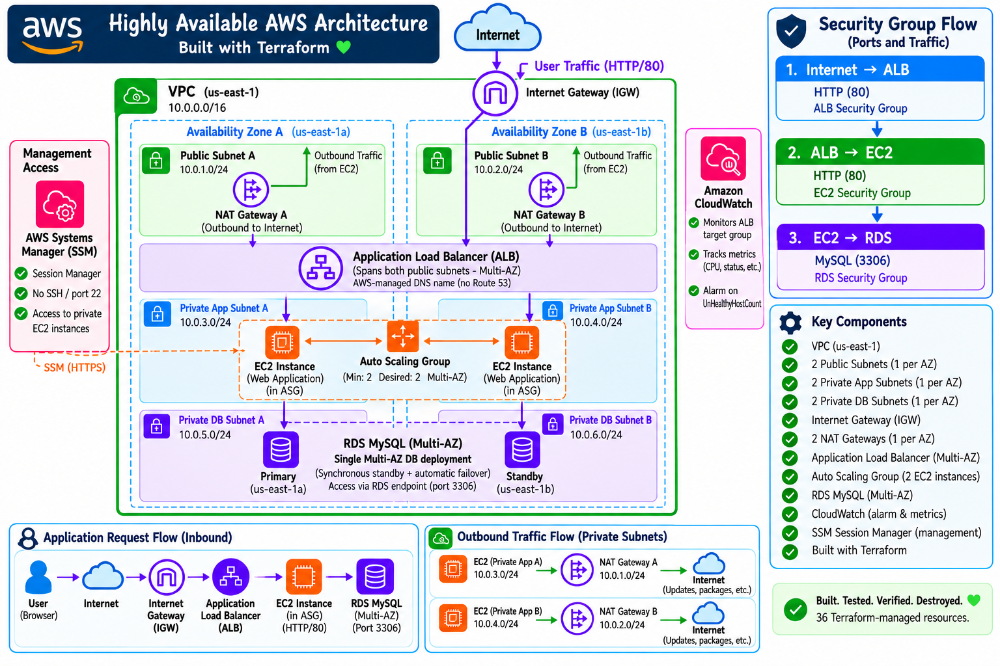

The environment spans two Availability Zones in `us-east-1` and separates resources into public, private application, and private database tiers.

### Network Layout

| Tier                | Availability Zone A | Availability Zone B |
| ------------------- | ------------------- | ------------------- |
| Public              | `10.0.1.0/24`       | `10.0.2.0/24`       |
| Private Application | `10.0.3.0/24`       | `10.0.4.0/24`       |
| Private Database    | `10.0.5.0/24`       | `10.0.6.0/24`       |

**VPC CIDR:** `10.0.0.0/16`

---

## 🧰 Technologies Used

* AWS
* Terraform
* Amazon VPC
* Application Load Balancer
* EC2
* Auto Scaling
* Amazon RDS for MySQL
* Multi-AZ RDS
* NAT Gateway
* Internet Gateway
* AWS Systems Manager Session Manager
* IAM
* Security Groups
* Amazon CloudWatch
* Secrets Manager
* Linux / Amazon Linux 2023
* Apache HTTP Server
* MariaDB client
* SQL

---

## 🌐 Architecture Flow

### Inbound Application Traffic

```text
User
  ↓
Internet
  ↓
Internet Gateway
  ↓
Application Load Balancer
  ↓
Auto Scaling Group
  ↓
Private EC2 Instances
  ↓
RDS MySQL
```

The Application Load Balancer is deployed across two public subnets while the EC2 instances remain in private application subnets.

The EC2 instances do not require public IP addresses.

### Outbound Internet Access

Private EC2 instances use NAT Gateways for outbound internet connectivity:

```text
Private EC2 A
    ↓
NAT Gateway A
    ↓
Internet Gateway
    ↓
Internet
```

```text
Private EC2 B
    ↓
NAT Gateway B
    ↓
Internet Gateway
    ↓
Internet
```

A NAT Gateway was deployed in each Availability Zone to avoid introducing a single-AZ dependency for application-tier outbound connectivity.

---

## 🔐 Security Design

The architecture uses security-group references instead of exposing backend resources directly to the internet.

```text
Internet
   ↓ HTTP :80
ALB Security Group
   ↓ HTTP :80
EC2 Security Group
   ↓ MySQL :3306
RDS Security Group
```

### ALB Security Group

Allows HTTP traffic from:

```text
0.0.0.0/0 → TCP 80
```

### EC2 Security Group

Allows HTTP only from the ALB security group:

```text
ALB Security Group → TCP 80
```

### RDS Security Group

Allows MySQL only from the EC2 security group:

```text
EC2 Security Group → TCP 3306
```

The database is not publicly accessible.

---

## 🖥️ Private EC2 Management with SSM

The EC2 instances were intentionally deployed without public IP addresses and without inbound SSH access.

Instead of opening port 22, the instances are managed using AWS Systems Manager Session Manager.

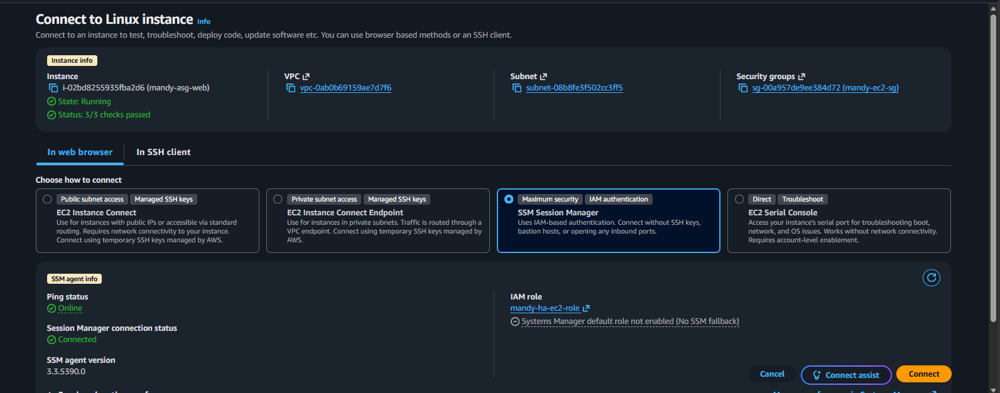

The Terraform configuration creates:

* An IAM role trusted by EC2
* The `AmazonSSMManagedInstanceCore` policy attachment
* An EC2 instance profile
* Private EC2 instances capable of registering with Systems Manager

This provides administrative access without managing SSH keys or exposing SSH to the network.

---

## ⚖️ Testing the Application Load Balancer

Each EC2 instance retrieves its instance ID and Availability Zone through IMDSv2 during startup.

The information is dynamically inserted into the web page by `user-data.sh`.

This made it possible to refresh the ALB endpoint and see requests reach different instances.

### Request served from Availability Zone A

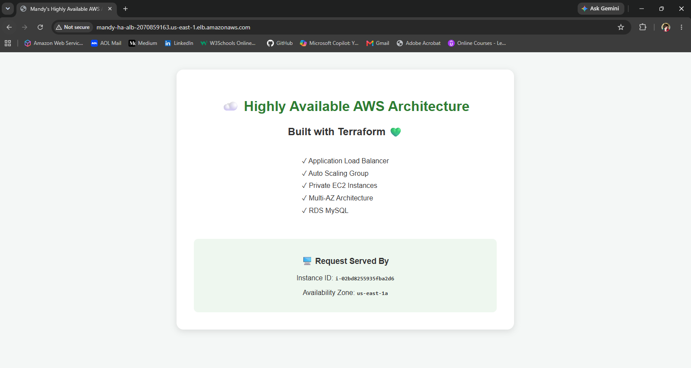

### Request served from Availability Zone B

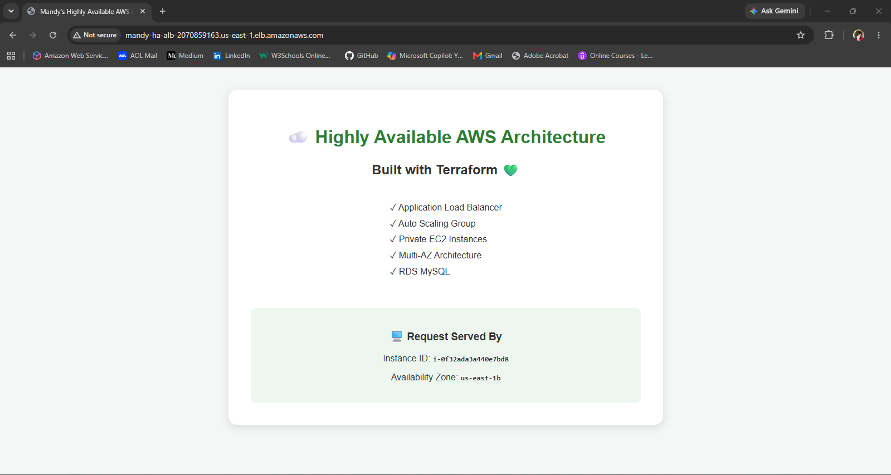

This demonstrated that the Application Load Balancer was successfully distributing requests across healthy targets in multiple Availability Zones.

---

## 🚀 Auto Scaling Group

The application instances are managed by an Auto Scaling Group configured with:

```text
Minimum capacity: 2
Desired capacity: 2
Maximum capacity: 4
```

Instances are distributed across both private application subnets.

The ASG is connected directly to the ALB target group and uses ELB health checks to help determine instance health.

---

## 🗄️ Multi-AZ RDS MySQL

Amazon RDS provides the persistent database tier.

The database was deployed:

* Inside private DB subnets
* With public access disabled
* With storage encryption enabled
* Across multiple Availability Zones
* With an AWS-managed master password
* Behind an RDS security group allowing MySQL only from the EC2 tier

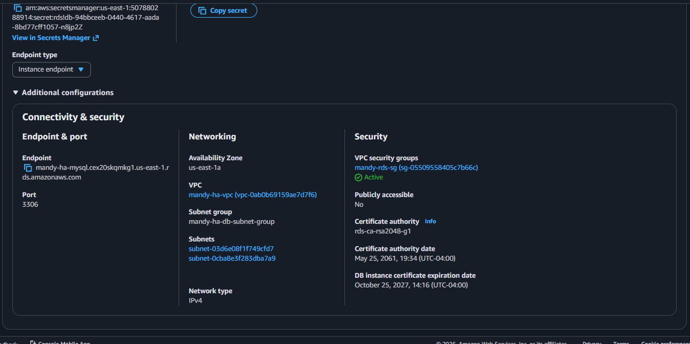

The application tier accesses the database through the RDS endpoint on port `3306`.

For Multi-AZ deployment, AWS maintains a synchronous standby in another Availability Zone and provides a single RDS endpoint for database connectivity.

---

## 🧪 Actually Using the Database

Rather than stopping after provisioning RDS, I connected to the database from one of the private EC2 instances using Session Manager and the MariaDB client.

I created a simple `tickets` table:

```sql
CREATE TABLE tickets (
    ticket_id INT AUTO_INCREMENT PRIMARY KEY,
    employee_name VARCHAR(100),
    issue VARCHAR(255),
    status VARCHAR(50)
);
```

Sample records were added to simulate IT service desk tickets.

The database was then queried and updated using SQL commands such as:

```sql
SHOW DATABASES;

USE mandyapp;

SHOW TABLES;

SELECT * FROM tickets;

UPDATE tickets
SET status = 'Resolved'
WHERE ticket_id = 1;
```

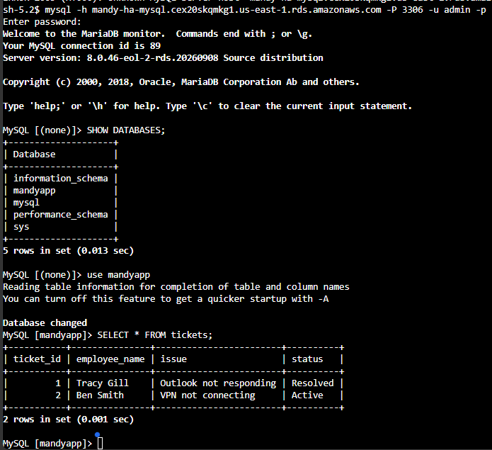

This provided hands-on practice with both RDS connectivity and basic SQL operations.

---

## 💀 Failure Testing: Terminating an EC2 Instance

A highly available architecture is more interesting when something actually fails.

So I manually terminated one of the EC2 instances managed by the Auto Scaling Group.

The ASG detected that actual capacity had fallen below desired capacity and automatically launched a replacement instance.

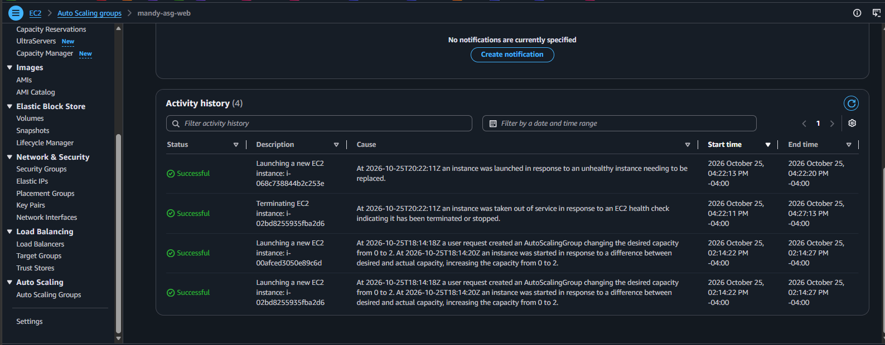

The replacement instance:

1. Launched in the application tier
2. Received the EC2 IAM role and instance profile
3. Ran `user-data.sh`
4. Installed Apache
5. Installed the MariaDB client
6. Generated the custom application page
7. Registered with the target group
8. Passed ALB health checks
9. Began receiving application traffic

No manual server configuration was required.

---

## 💾 EC2 Was Disposable. The Data Wasn't.

After the original EC2 instance was terminated and replaced, I connected to RDS from the newly created instance.

The previously created database records were still there.

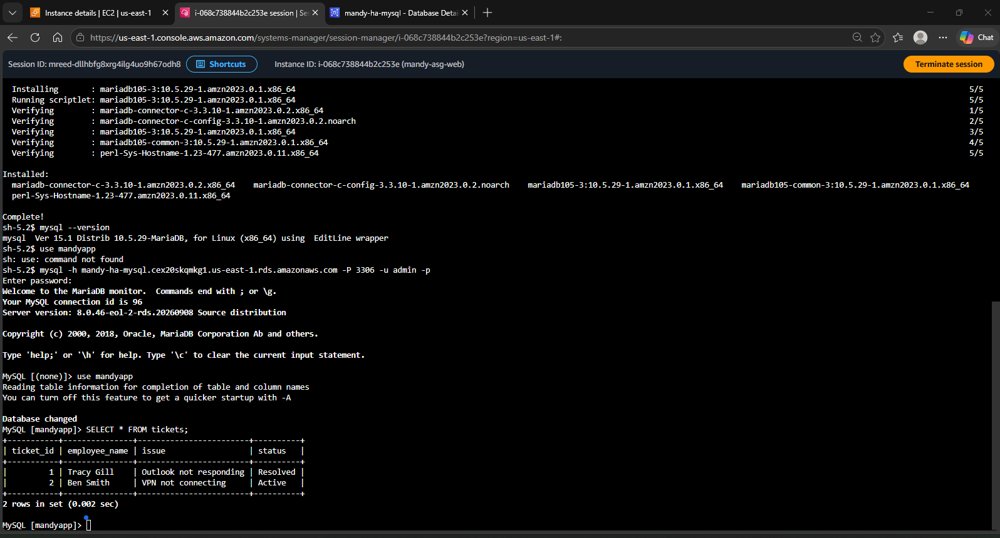

This demonstrated an important cloud architecture principle:

> Compute resources can be disposable while application data persists independently in the database tier.

The EC2 instance could disappear completely without deleting the application data stored in RDS.

---

## 💚 Target Group Recovery

After Auto Scaling launched the replacement instance and the application initialized successfully, the ALB target group returned to:

```text
Healthy targets:   2
Unhealthy targets: 0
```

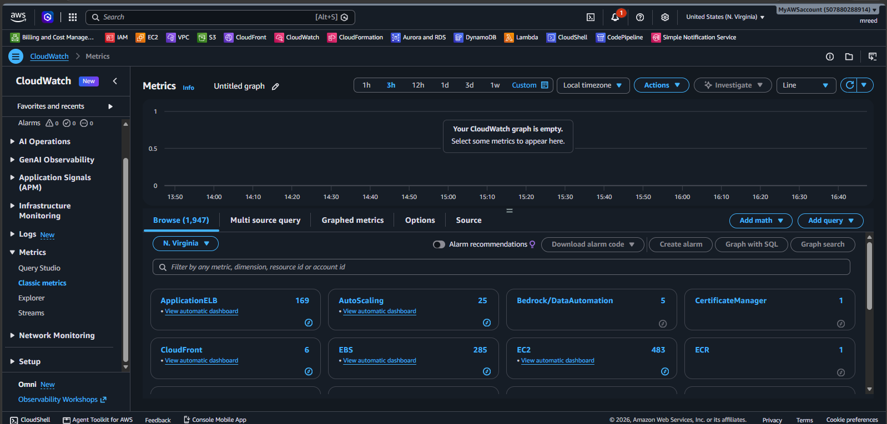

The architecture had automatically returned itself to the desired healthy state.

---

## 📊 Monitoring with CloudWatch

CloudWatch metrics were used to observe target health during failure testing.

When an EC2 instance was terminated, the ALB metric:

```text
UnHealthyHostCount
```

temporarily increased.

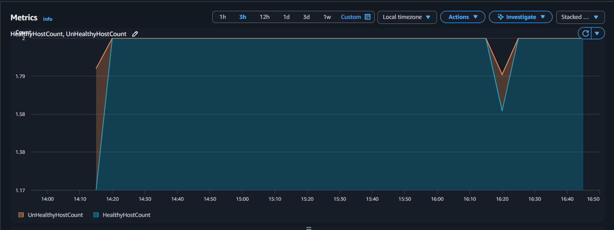

As the Auto Scaling Group replaced the instance and the new target passed its health checks, the unhealthy target count returned to zero.

This connected the infrastructure event directly to an observable CloudWatch metric.

---

## 🚨 CloudWatch Alarm

A CloudWatch alarm was also created with Terraform to monitor unhealthy ALB targets.

The alarm condition was:

```text
UnHealthyHostCount >= 1
```

The failure test produced the exact metric condition the alarm was designed to detect.

After the replacement instance became healthy, the alarm returned to `OK`.

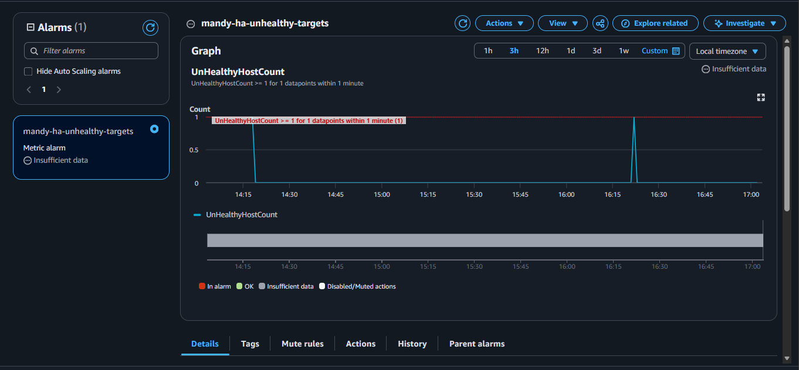

This completed the full operational flow:

```text
EC2 failure
    ↓
ALB detects unhealthy target
    ↓
CloudWatch records UnHealthyHostCount
    ↓
Alarm threshold is crossed
    ↓
Auto Scaling restores capacity
    ↓
Replacement passes health checks
    ↓
UnHealthyHostCount returns to 0
    ↓
Alarm returns to OK
```

---

## 🔗 Terraform Resource Linkage

One of the main goals of this project was understanding how Terraform resources pass values to one another rather than treating each resource as isolated configuration.

Examples include:

```hcl
vpc_id = aws_vpc.main.id
```

The VPC resource produces an ID that downstream resources consume.

```hcl
subnet_id = aws_subnet.public_a.id
```

The NAT Gateway consumes the ID produced by the public subnet.

```hcl
allocation_id = aws_eip.nat_a.allocation_id
```

The NAT Gateway consumes the allocation ID produced by the Elastic IP resource.

```hcl
security_groups = [aws_security_group.alb.id]
```

The EC2 security group references the ALB security group directly rather than using an IP range.

```hcl
security_groups = [aws_security_group.ec2.id]
```

The RDS security group similarly allows traffic from the application security group.

```hcl
load_balancer_arn = aws_lb.web.arn
```

The listener consumes the ARN produced by the Application Load Balancer.

```hcl
target_group_arn = aws_lb_target_group.web.arn
```

The listener and Auto Scaling configuration reference the target group created elsewhere in the Terraform configuration.

```hcl
image_id = data.aws_ami.amazon_linux.id
```

The launch template consumes the AMI ID returned by the Amazon Linux data source.

```hcl
user_data = base64encode(file("${path.module}/user-data.sh"))
```

Terraform reads the external startup script, Base64 encodes it, and supplies it to newly launched EC2 instances.

These references allow Terraform to understand dependencies and build the resource graph automatically.

---

## ⚙️ Automated EC2 Bootstrap

The launch template uses `user-data.sh` to configure every EC2 instance automatically.

The script:

* Updates packages
* Installs Apache
* Installs the MariaDB client
* Enables Apache at boot
* Retrieves an IMDSv2 token
* Retrieves the EC2 instance ID
* Retrieves the Availability Zone
* Generates the custom application page
* Starts Apache

Because the script belongs to the launch configuration rather than an individual server, replacement instances receive the same configuration automatically.

This was verified during the failure test when a replacement EC2 instance launched and already had the MariaDB client installed.

---

## 🧠 Key Lessons

### High availability is more than having two servers

The architecture distributes components across multiple Availability Zones and removes several single-instance dependencies.

### Public and private are architectural decisions

The ALB needs internet-facing connectivity.

The application instances do not.

The database definitely does not.

### NAT Gateway is not part of inbound application traffic

Inbound requests follow:

```text
Internet → IGW → ALB → EC2
```

NAT Gateways are used when private resources initiate outbound connections:

```text
EC2 → NAT Gateway → IGW → Internet
```

### Security groups can reference other security groups

Using:

```text
ALB SG → EC2 SG → RDS SG
```

is more precise than allowing broad VPC CIDR ranges.

### Auto Scaling is about desired state

When an instance was terminated, the ASG did not care that the deletion was intentional.

Desired capacity was `2`.

Actual capacity became `1`.

So Auto Scaling launched another instance.

### Persistent data should not depend on disposable compute

The EC2 instance disappeared.

The RDS records remained.

The replacement EC2 instance connected to the same database and retrieved the existing records.

### Observability matters

CloudWatch provided evidence of the failure and recovery rather than relying only on what appeared in the browser.

---

## 📁 Project Structure

```text
terraform-ha-2tier-aws/
│
├── .gitignore
├── .terraform.lock.hcl
├── README.md
├── index.html
├── main.tf
├── outputs.tf
├── providers.tf
├── user-data.sh
├── variables.tf
│
└── screenshots/
    ├── 01-architecture-diagram.png
    ├── 02-application-load-balanced-az-a.png
    ├── 03-application-load-balanced-az-b.png
    ├── 04-private-ec2-ssm-session-manager.png
    ├── 05-rds-connectivity-security.png
    ├── 06-rds-database-and-ticket-data.png
    ├── 07-rds-data-persists-after-ec2-replacement.png
    ├── 08-asg-self-healing-activity-history.png
    ├── 09-target-group-two-healthy-targets.png
    ├── 10-cloudwatch-unhealthy-host-metric.png
    ├── 11-cloudwatch-alarm-ok-after-recovery.png
    ├── 12-terraform-destroy-plan-36-resources.png
    ├── 13-alb-dns-gone-after-destroy.png
    └── 14-terraform-destroy-complete-36-resources.png
```

Terraform state, `.terraform/`, and local `.tfvars` files are intentionally excluded from version control.

---

## 🚀 Terraform Workflow

Initialize Terraform:

```bash
terraform init
```

Format the configuration:

```bash
terraform fmt
```

Validate the configuration:

```bash
terraform validate
```

Review the execution plan:

```bash
terraform plan
```

Deploy:

```bash
terraform apply
```

After deployment, Terraform outputs the ALB DNS name and RDS endpoint.

---

## 🔥 Clean Teardown

Because this project creates resources such as NAT Gateways, an Application Load Balancer, EC2 instances, and Multi-AZ RDS, the environment was destroyed after testing.

Before destruction:

```bash
terraform plan -destroy
```

Terraform identified:

```text
Plan: 0 to add, 0 to change, 36 to destroy.
```

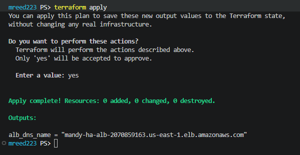

Then:

```bash
terraform destroy
```

As the infrastructure disappeared, the former ALB DNS endpoint stopped resolving.

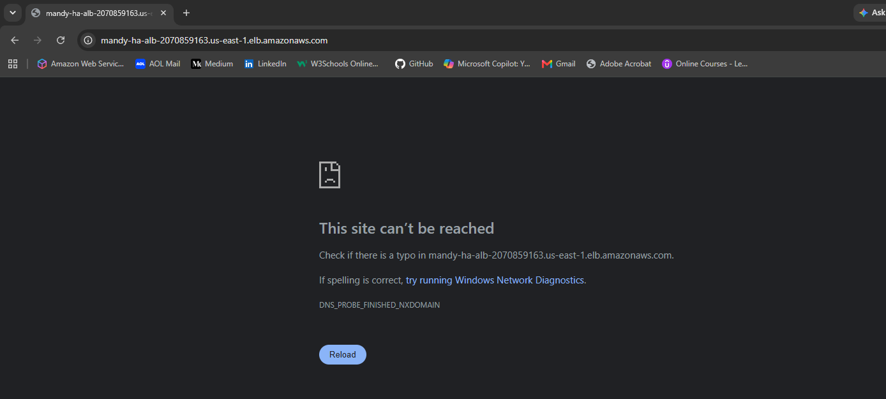

Finally:

```text
Destroy complete! Resources: 36 destroyed.
```

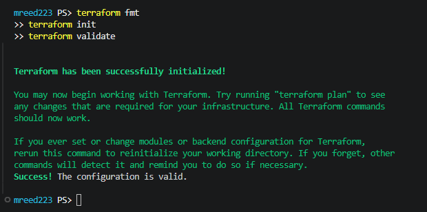

**Built. Tested. Verified. Destroyed. 💚**

---

## 🎯 What This Project Demonstrated

This project provided hands-on experience with:

* Infrastructure as Code
* Terraform resource dependencies
* Multi-AZ architecture
* VPC design
* Public and private subnet separation
* Internet and NAT Gateway routing
* Application Load Balancing
* Auto Scaling and self-healing
* Private EC2 management with SSM
* IAM roles and instance profiles
* Security-group chaining
* RDS MySQL
* Multi-AZ database architecture
* Basic SQL
* Persistent database storage
* EC2 user data automation
* IMDSv2
* CloudWatch metrics
* CloudWatch alarms
* Failure testing
* Infrastructure teardown

Most importantly, the project went beyond simply creating AWS resources.

The architecture was deliberately broken, observed, recovered, queried, monitored, and ultimately destroyed to verify how the individual AWS services worked together as a complete system.
